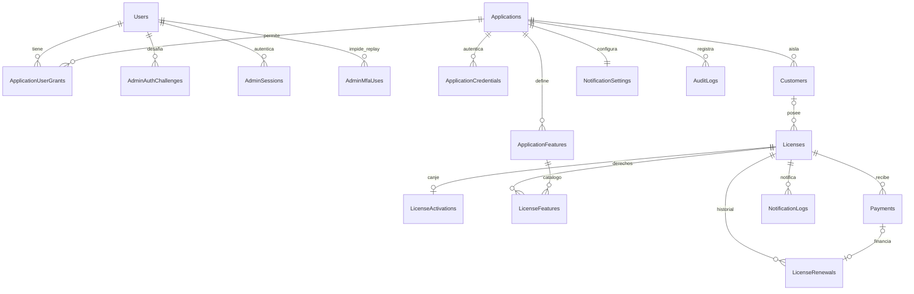

# Modelo relacional PostgreSQL

UUID para IDs públicos. Fechas `timestamptz` UTC; dinero `numeric(19,4)` y currency ISO 4217. Campos de texto tienen límites iguales al contrato. Concurrencia optimista con Version bigint incrementado por mutación y expuesto como ETag administrativo; bloqueos de fila para canje, renovación y confirmación. Nunca usar reloj del cliente.

| Entidad | Campos y restricciones principales |
|---|---|
| Users/Roles | Tablas estándar Identity, usuarios internos; MFA y lockout |
| ApplicationUserGrants | UserId, ApplicationId, capability; PK compuesta |
| Applications | Id, Name, Slug UNIQUE, IsActive, Version, CreatedAt |
| ApplicationCredentials | Id, ApplicationId FK, SecretHash, scopes, CreatedAt, ExpiresAt, RevokedAt; índice (ApplicationId,Id); secreto solo en creación |
| Customers | Id, ApplicationId FK, SubjectId, DisplayName, Email, Version; UNIQUE(ApplicationId,SubjectId), UNIQUE(ApplicationId,Id) |
| Licenses | Id, ApplicationId, CustomerId opcional, KeyHash UNIQUE, State, StartMode, DurationUnit/Value, StartsAt, ActivatedAt, ExpiresAt nullable, IsLifetime, EntitlementVersion, Version; UNIQUE(ApplicationId,Id) |
| LicenseActivations | Id, ApplicationId, LicenseId, CustomerId, SubjectId, ActivatedAt; UNIQUE(LicenseId) |
| LicenseRenewals | Id, ApplicationId, LicenseId, OperationId, PaymentId nullable, BeforeExpiresAt, AfterExpiresAt, BeforeLifetime, AfterLifetime, Reactivated, ActorId, Reason, CreatedAt; UNIQUE(ApplicationId,OperationId); UNIQUE(PaymentId) cuando no null |
| ApplicationFeatures | ApplicationId, Code, Name, IsActive; PK(ApplicationId,Code); código estable y case-sensitive |
| LicenseFeatures | ApplicationId, LicenseId, FeatureCode; PK(LicenseId,FeatureCode); FK compuesta a catálogo y licencia |
| Payments | Id, ApplicationId, LicenseId, CustomerId, Amount, Currency, State, Reference, RenewalIntent JSON validado, Version, CreatedAt, ConfirmedAt; UNIQUE(ApplicationId,Reference) |
| NotificationSettings | ApplicationId PK/FK, offsets y regla corta duración, canales, Version |
| NotificationTemplates | ApplicationId, EventType, Locale, Subject, SanitizedBody, Version; PK compuesta |
| NotificationLogs | Id, ApplicationId, LicenseId, CustomerId, EventType, EntitlementVersion, OffsetSeconds, Channel, ScheduledAt, State, Attempts, ProviderId, LastErrorRedacted; clave de deduplicación UNIQUE |
| NotificationOutbox | Id, EventType, AggregateId, AggregateVersion, payload mínimo, CreatedAt, ProcessedAt, lease y retries; índice pendientes |
| AuditLogs | Id, ApplicationId nullable para eventos globales, ActorId/principal, Action, EntityId, Reason, CorrelationId, CreatedAt; append-only |
| IdempotencyRecords | ApplicationId, PrincipalId, Operation, Key, RequestHash, ResponseWithoutSecrets, State, CreatedAt, RetainUntil; PK compuesta |

Customer representa una cuenta/negocio de una aplicación; contacto repetido entre aplicaciones se conserva aislado. No hay unión global por email. FK (ApplicationId,CustomerId), (ApplicationId,LicenseId) y (ApplicationId,FeatureCode) impiden referencias cruzadas. Borrado restrictivo en entidades con historial; desactivar o cancelar en lugar de borrar. CustomerId de emisión opcional preasigna destinatario y obliga a que el subjectId de canje coincida. Un sujeto sin preasignación crea Customer dentro de la transacción, sin datos de contacto inventados.

Índices: Licenses(ApplicationId,State,ExpiresAt,Id), Customers(ApplicationId,SubjectId), Payments(ApplicationId,State,CreatedAt,Id), AuditLogs(ApplicationId,CreatedAt,Id), NotificationLogs(ApplicationId,CustomerId,ScheduledAt,Id). Índice único parcial Licenses(ApplicationId,CustomerId) WHERE ActivatedAt IS NOT NULL AND State IN ('Active','Suspended'); el estado almacenado debe reconciliarse bajo bloqueo antes de vincular una nueva licencia. CHECK IsLifetime implica ExpiresAt IS NULL; licencia finita iniciada implica ExpiresAt > StartsAt; DurationValue > 0 cuando hay duración; no códigos claros persistidos.

## Estados y tiempo

Pending -> Active al canjear; Pending -> Suspended/Revoked/Cancelled por administrador; Pending -> Expired si comenzó al emitir y venció sin canje. Suspended -> Active o Pending al reactivar según si ya se canjeó y si inició vigencia; si venció requiere renovación explícita o queda Expired. Active -> Suspended/Revoked/Expired. Expired -> Active por renovación solamente si ya fue canjeada; clave expirada sin canje no se renueva. Revoked -> Active solo por renovación con reactivate:true, permiso especial y canje previo. Suspended -> Revoked/Cancelled; Active -> Cancelled por operación administrativa explícita. Expired -> Revoked/Cancelled. Revoked -> Cancelled. Cancelled terminal. El servidor comprueba la transición y audita cada cambio.

Generar no otorga derechos. Inicio al emitir fija StartsAt/ExpiresAt pero permanece Pending hasta canje. Inicio al activar conserva fechas null hasta canje. Lifetime nunca expira, pero estados de bloqueo invalidan derechos. Mes/año calendario: AddMonths/AddYears sobre instante UTC, conserva hora y ajusta día al último válido (31 enero + 1 mes -> 28/29 febrero; 29 febrero + 1 año -> 28 febrero). Minuto/hora/día son 60/3600/86400 segundos; meses/años no se convierten en días. `duration.value` es entero positivo. Una operación aplica el incremento completo una vez desde su base; no encadenar incrementos de un mes, pues cambia el ajuste.

## Migraciones planificadas

Fase 2 consolidó las entidades diseñadas en una migración inicial `20261011161920_InitialSchema`; Hangfire conserva esquema separado, provisionado explícitamente en desarrollo para limpieza de autenticación; jobs de notificaciones siguen pendientes. EF generó migración y snapshot reales; `docker/migrations.sql` es el script idempotente con trigger append-only de auditoría. Los registros de persistencia viven en Infrastructure y no son DTOs del SDK. ApplicationFeatures/LicenseFeatures/NotificationSettings tienen UUID técnico como PK y claves/índices únicos compuestos para preservar la unicidad lógica descrita arriba. Verificar restricciones con PostgreSQL real, nunca sustituir concurrencia por EF InMemory. Ensayar upgrade desde base vacía y desde snapshot anterior con respaldo restaurable. Migración inicial y migración AdminAuthentication aplicadas localmente contra PostgreSQL 17 real.

Fase 3 añade AdminAuthChallenges (Id, UserId, SecurityStamp, ExpiresAt, ConsumedAt), AdminSessions (Id, UserId, SecurityStamp, ExpiresAt, RevokedAt) y AdminMfaUses (PK UserId/TokenHash, ExpiresAt). FK restrictivas a Users e índices de expiración. Bloqueo PostgreSQL por usuario serializa login, consumo MFA y logout. Los registros de auth no contienen contraseñas ni códigos en claro; el almacén estándar Identity conserva la clave de autenticador según su modelo. Limpieza de registros expirados pendiente de mantenimiento persistente.

